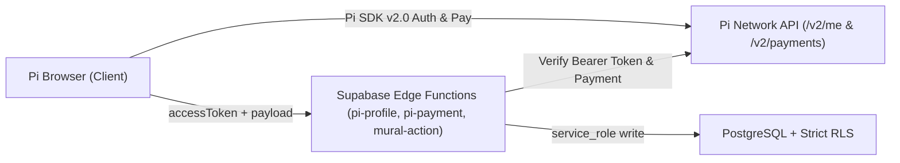

# HOKAGE22B — Pi Network Hackathon Submission

**Live Hackathon Judge Portal:** `https://hokage22b.com/hackathon`  
**Live Pioneer Storefront Demo:** `https://hokage22b.com/@hokage22b`  
**Live Pioneer Classifieds Mural:** `https://hokage22b.com/mural`  

---

## 1. Problem & Solution
Pioneers migrating to Pi Mainnet lack a trusted, zero-fee way to showcase products, accept Pi in person or online, and discover verified local/global merchants.

**HOKAGE22B** unifies three Pi-native pillars:
1. **Free Web3 Storefronts (`pioneiro`)**: Linktree-style profile tied to verified Pi identity, Stellar public-key (`G...`) validation, product catalog with dual reference pricing (`π` + local currency), and verified P2P reviews.
2. **Dynamic Pi POS QR Engine**: Instant QR code terminal with pre-filled Pi amount and memo for physical stores and remote P2P orders.
3. **Pi-First Global Classifieds Mural (`mural`)**: Country-filterable marketplace (`GLOBAL`, `BR`, `US`, `PT`, `NG`, `PH`, `VN`, `IN`, etc.) where every listing accepts Pi, storefront items can be promoted in 1 click, and ads have a 24h edit transparency window.

---

## 2. Zero-Trust Architecture

### Security Controls Implemented
- **Server-Side Pi Identity Verification**: `pi-profile` and `mural-action` validate `accessToken` directly against `https://api.minepi.com/v2/me`.
- **Server-Side Payment Verification & Anti-Replay**: `pi-payment` and `mural-action` verify payment completion, `user_uid`, and minimum tier amount against `/v2/payments/{paymentId}`, backed by a unique index on `payment_txid`.
- **Strict PostgreSQL RLS**: Direct `anon` `INSERT`/`UPDATE`/`DELETE` policies and sensitive RPC execution (`pioneer_update_my_ad`, `pioneer_renew_ad`) are revoked from `anon`.
- **24h Edit Window & Anti-Spam**: Ads can only be edited by the authenticated owner within 24 hours of creation; comments enforce a 15-second server-side cooldown; 5 distinct reports trigger automatic moderation.
- **Zero Custody**: Never requests passphrases/seed phrases; validates Stellar public keys via `^G[A-Z2-7]{55}$`.

---

## 3. Judge Walkthrough (60 Seconds)
1. Open `https://hokage22b.com/hackathon` inside **Pi Browser** (auto-renders in English for non-`pt` browsers, with `EN | PT` toggle).
2. Click **Try Live Storefront (`@hokage22b`)** to inspect verified wallet, dual-priced catalog, and verified reviews.
3. Click **Test POS QR Checkout** to generate a dynamic Pi payment QR code.
4. Click **Explore Pi Mural** to test country/Pi filters, comments, and 1-click promotion from a storefront.
